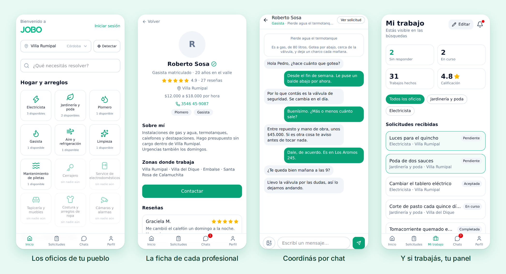
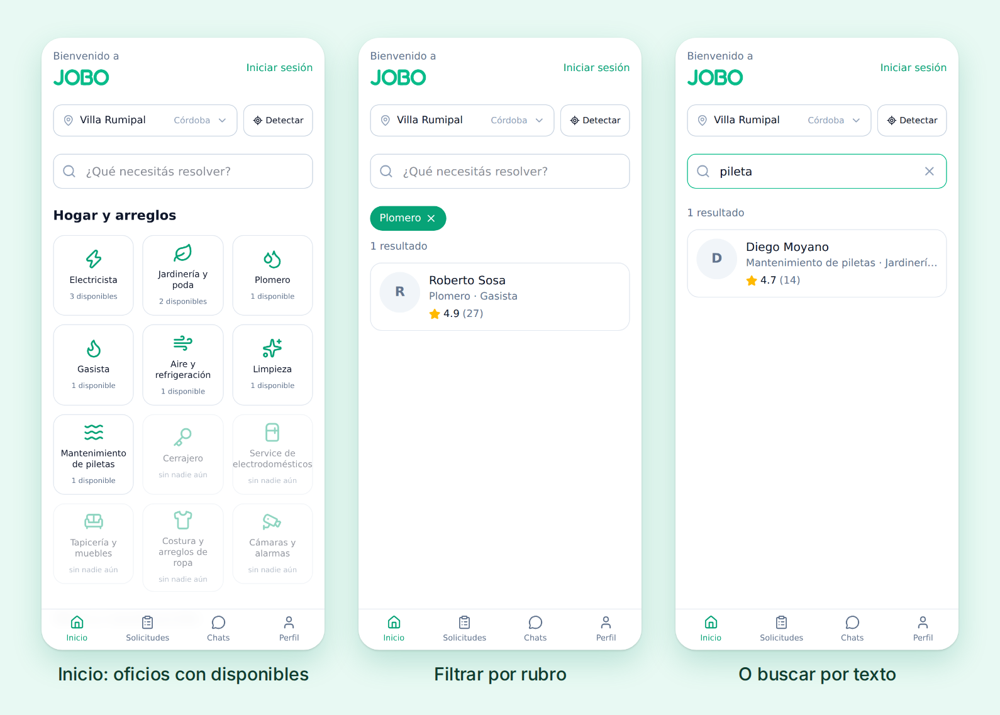
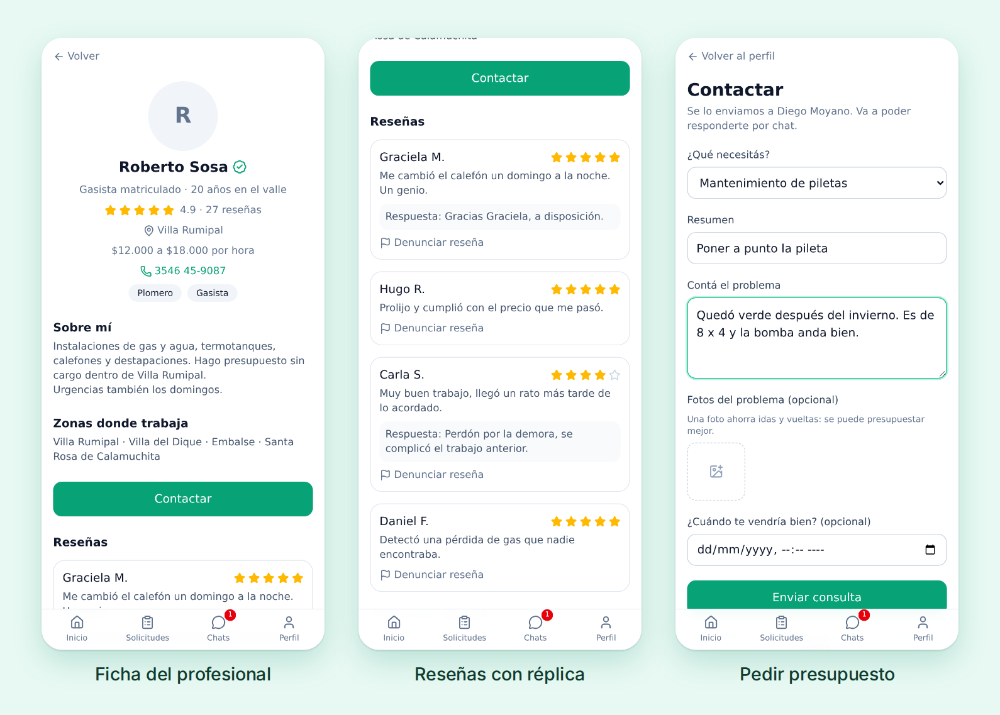
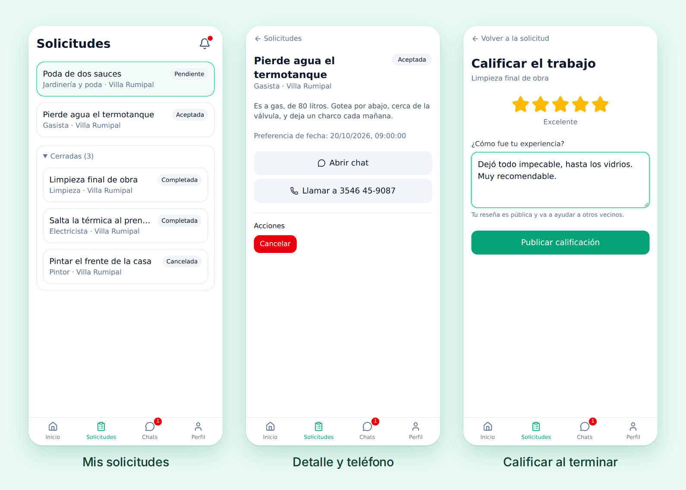
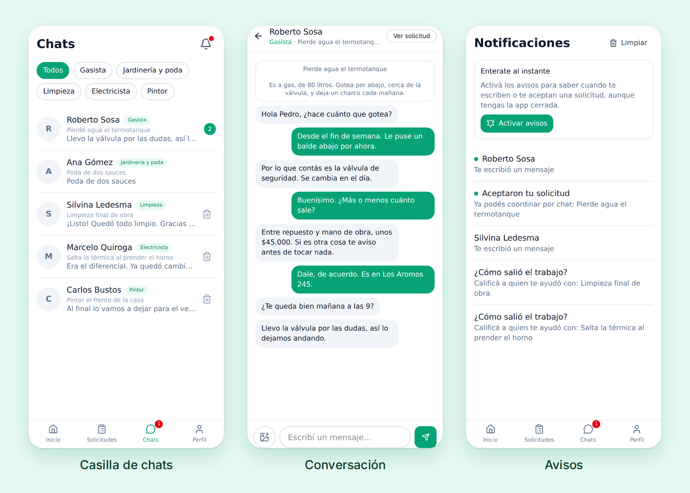
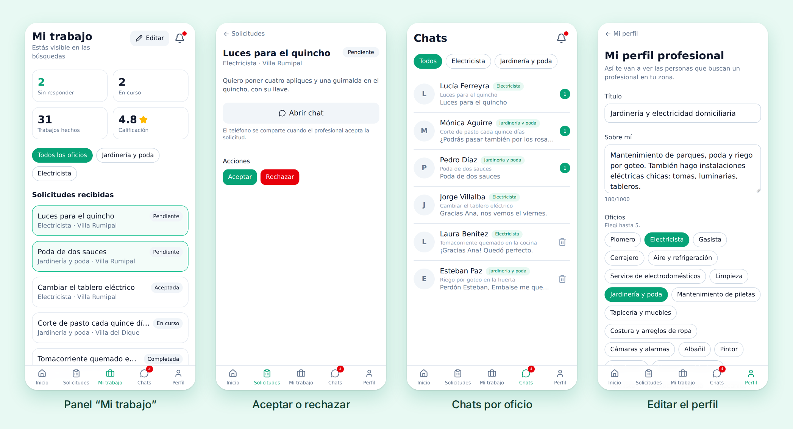
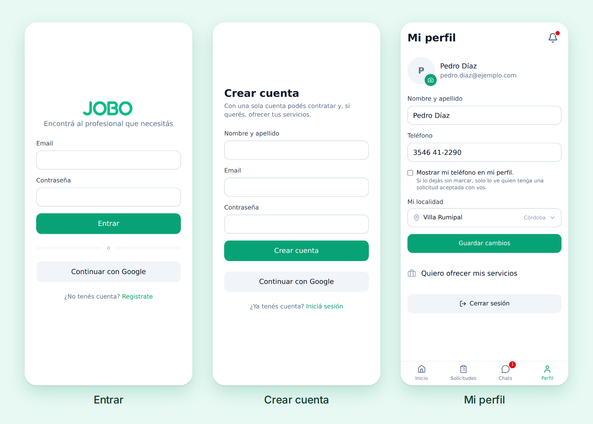
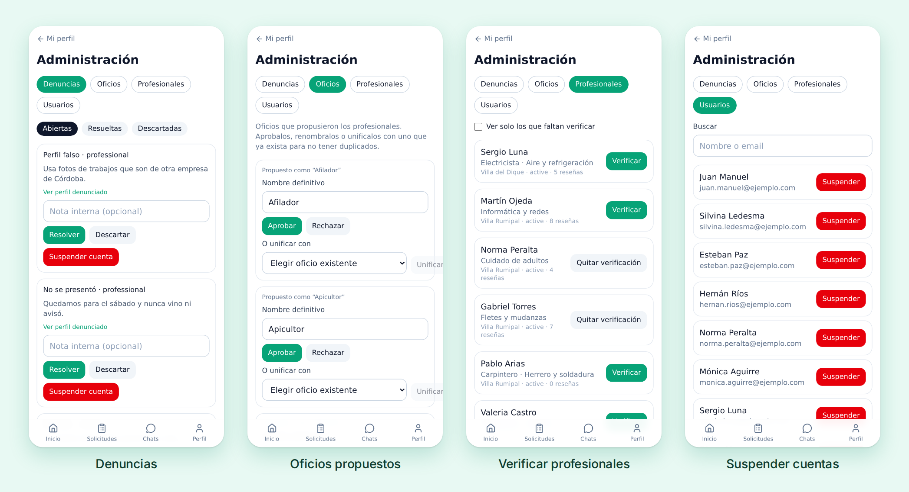
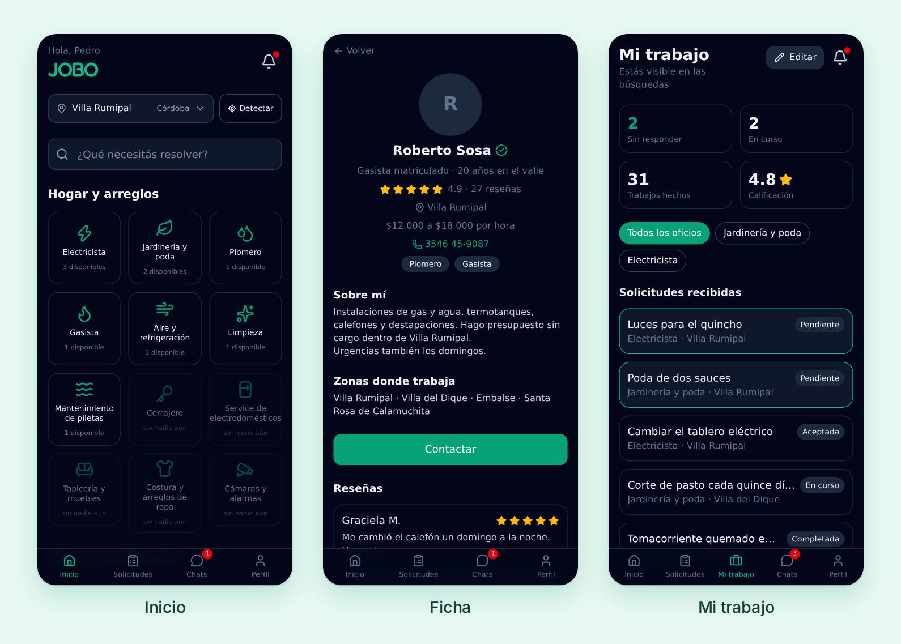

# Jobo

App para conectar personas que necesitan resolver un problema (una canilla que
pierde, una instalación eléctrica) con profesionales de su pueblo o ciudad.

Es una **PWA mobile-first**: se usa desde el navegador del teléfono y se puede
instalar como una app, con avisos push. Está publicada en
**https://jobo-8b688.web.app**.



- [Cómo se usa](#cómo-se-usa)
  - [Buscar](#buscar)
  - [Ficha y contacto](#ficha-y-contacto)
  - [Solicitudes](#solicitudes)
  - [Chat y avisos](#chat-y-avisos)
  - [Para quien ofrece servicios](#para-quien-ofrece-servicios)
  - [Cuenta](#cuenta)
  - [Administración](#administración)
  - [Tema oscuro](#tema-oscuro)
- [Stack](#stack)
- [Decisiones de diseño](#decisiones-de-diseño)
- [Puesta en marcha](#puesta-en-marcha)
- [Capturas](#capturas)
- [Estructura](#estructura)

## Cómo se usa

Las capturas muestran un pueblo de ejemplo, Villa Rumipal (Córdoba), con
profesionales, vecinos y conversaciones inventadas. Las arma
`npm run capturas` sobre los emuladores; ver [Capturas](#capturas).

### Buscar

No hace falta cuenta para buscar. La home muestra los oficios agrupados por
rubro y, para la localidad elegida, cuántos profesionales hay disponibles en
cada uno: los que tienen gente van primero y los vacíos quedan atenuados, para
que se vea qué falta en el pueblo. La localidad se busca por nombre entre las
4037 del país, o se adivina con **Detectar**.

Tocar un oficio o escribir en el buscador cambia la grilla por los
resultados, sin salir de la home. La búsqueda por texto mira nombre, título,
descripción y oficios, sin importar acentos ni mayúsculas.



### Ficha y contacto

La ficha pública muestra la calificación, la localidad, el precio por hora
orientativo, los oficios, las zonas donde trabaja y las fotos de trabajos. El
teléfono aparece solo si el profesional lo marcó como público. La insignia
verde indica que un admin verificó el perfil.

Las reseñas son de trabajos completados: una por solicitud, con derecho a
réplica del profesional. Perfiles y reseñas se pueden denunciar.

**Contactar** abre el pedido de presupuesto: por qué oficio (si tiene varios),
un resumen, el problema contado con detalle, fotos opcionales y una fecha
preferida.



### Solicitudes

La solicitud es el hilo conductor: abre el chat, libera el teléfono cuando el
profesional la acepta y, al completarse, habilita la reseña. Lo que sigue
abierto va arriba y lo cerrado queda plegado en **Cerradas**.

Cada parte ve solo las acciones que le tocan: el profesional acepta, rechaza
o marca en curso; cualquiera de los dos puede completarla o cancelarla.



### Chat y avisos

Cada solicitud tiene su chat en tiempo real, etiquetado con el oficio y el
título del pedido, y se pueden mandar fotos. La casilla filtra por oficio y
marca los no leídos. Las charlas de trabajos ya cerrados se pueden eliminar:
el borrado es solo para quien lo hace, y si la otra persona vuelve a escribir,
la charla reaparece.

Los avisos llegan por push al teléfono, aun con la app cerrada, y quedan en el
historial de la campana: una entrada por conversación y una por cada cambio en
una solicitud.



### Para quien ofrece servicios

Cualquier cuenta puede activar su perfil profesional desde **Mi perfil**; no
hace falta una cuenta aparte. Al activarlo aparece la pestaña **Mi trabajo**,
con lo que espera respuesta, lo que está en curso, los trabajos hechos y la
calificación. Las solicitudes recibidas y la casilla se filtran por oficio:
alguien puede ser jardinero y electricista a la vez, y el chat recuerda por
cuál lo contactaron.

En el perfil profesional se eligen hasta cinco oficios (o se propone uno que
no está en la lista), la localidad y las zonas donde trabaja, el rango de
precio, las fotos de trabajos y si está disponible o en pausa.



### Cuenta

Se entra con email o con Google. En **Mi perfil** se editan el nombre, la
foto, la localidad y el teléfono, que por defecto solo ve quien tiene una
solicitud aceptada.



### Administración

El panel `/admin` es solo para cuentas con el custom claim de admin. Tiene
cuatro solapas:

- **Denuncias**: se resuelven o descartan con una nota interna, y se puede
  suspender la cuenta denunciada.
- **Oficios**: aprobar, renombrar o unificar los oficios que proponen los
  profesionales, para no tener "Plomería" y "Plomero".
- **Profesionales**: verificar identidad o matrícula.
- **Usuarios**: buscar y suspender o reactivar cuentas.



### Tema oscuro

La app sigue el tema del teléfono.



## Stack

| Pieza | Elección |
| --- | --- |
| Build | Vite 8 + React 19 + TypeScript strict |
| Estilos | Tailwind CSS v4 (`@tailwindcss/vite`) |
| Routing | React Router (`createBrowserRouter`) |
| Backend | Firebase Auth, Firestore, Storage, Cloud Functions, FCM |
| Estado | Contexto para la sesión, Zustand para la localidad elegida |
| PWA | `vite-plugin-pwa` |

## Decisiones de diseño

- **Cuenta única.** Todos se registran igual; quien quiere ofrecer servicios
  activa un perfil profesional (`professionals/{uid}`). Así un plomero puede
  contratar un electricista sin tener dos cuentas.
- **Ubicación por localidad, no por GPS.** Guardamos el pueblo/ciudad, nunca
  coordenadas de nadie. El botón "Detectar" usa el GPS solo en el momento para
  adivinar la localidad más cercana del catálogo.
- **La solicitud es el hilo conductor.** `requests` habilita el chat, el
  intercambio de teléfono y, al completarse, la reseña. Una reseña por
  solicitud completada: el id de la reseña ES el id de la solicitud.
- **Los agregados no los escribe el cliente.** `ratingAvg`, `ratingCount`,
  `unreadCount` y los contadores de `stats/categories` los mantienen Cloud
  Functions; las reglas de seguridad bloquean su escritura desde la app.
- **Admin por custom claim.** El rol vive en el token de Firebase Auth, no en
  Firestore, para que nadie pueda dárselo a sí mismo editando su documento.

## Puesta en marcha

```bash
npm install
cp .env.example .env.local   # completar con las credenciales del proyecto
npm run dev
```

Scripts:

- `npm run dev` — servidor de desarrollo
- `npm run build` — build de producción
- `npm run typecheck` — chequeo de tipos
- `npm test` — todos los tests: reglas de Firestore (requiere los emuladores)
  y pantallas
- `npm run test:ui` — solo los tests de pantallas, sin emuladores
- `npm run seed` — carga los oficios en Firestore (¡apunta a producción si no
  se le pasa `FIRESTORE_EMULATOR_HOST`!)
- `npm run emulators` — emuladores de Firebase
- `npm run deploy:rules` — publica reglas e índices de Firestore y Storage
- `npm run capturas` — regenera las capturas de este README

### Hacerte super admin

```bash
npm run admin juan.androetto36@gmail.com
```

Usa las credenciales que ya dejó `firebase login` (o
`gcloud auth application-default login`); también acepta un
`GOOGLE_APPLICATION_CREDENTIALS` si preferís una clave de servicio.

La cuenta tiene que existir: iniciá sesión una vez en la app antes de correrlo.
Después hay que cerrar y volver a abrir sesión para que el token traiga el
permiso. El panel queda en `/admin`.

## Capturas

```bash
npm run capturas
```

`scripts/capturas.mjs` levanta los emuladores de Auth y Firestore con el
proyecto `demo-jobo`, carga el pueblo de ejemplo, abre la app en un Chromium a
tamaño de teléfono (390 × 844) y saca una captura por pantalla en
`docs/capturas/pantallas/`. Con esas arma las composiciones de
`docs/capturas/*.png` que usa este README.

Nunca toca producción. Los emuladores corren en puertos propios (Auth 9399,
Firestore 8380, configurados en `firebase.capturas.json`), así que puede
convivir con un `npm run emulators` abierto.

Si Chromium no arranca por falta de `libnspr4.so`, hay que apuntar
`LD_LIBRARY_PATH` a las librerías que bajó Playwright:

```bash
LD_LIBRARY_PATH=~/.cache/ms-playwright/libs/root/usr/lib/x86_64-linux-gnu npm run capturas
```

Todo cambio visible en la app actualiza las capturas y este README.

## Estructura

```
src/
  app/          router, layout con barra inferior, guards de ruta
  components/   UI compartida (Button, Input, EmptyState…)
  features/     auth, professionals, requests, chat, reviews, admin, localities
  lib/          firebase, catálogo de categorías y localidades, utils
  pages/        una por pantalla; arman el estado y usan los componentes de features/
  types/        modelo de datos de Firestore
scripts/        seed, admin, catálogo de localidades y capturas
docs/capturas/  imágenes de este README
```
